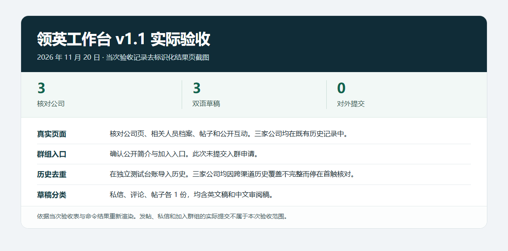

# 领英运营与主动获客工作台

一套面向 B2B 团队的 AI Agent 技能与本地工作台。从发现企业和岗位、核对已联系对象，到双语内容准备、逐版审阅和逐项记回执。个人和团队可以按自己的产品、市场和行业建立独立知识库。

[多客户端安装指南](docs/CLIENTS.zh-CN.md) · [销售经理实操](references/销售经理领英实操手册.md) · [本地操作手册](references/本地操作手册.md) · [验收报告](docs/ACCEPTANCE.zh-CN.md)

## 能做什么

| 工作 | 交付 |
| --- | --- |
| 主动找客户 | 用公司官网、行业目录、实际可见的公开帖子和讨论核对企业、业务场景、相关岗位、来源和下一步。 |
| 历史排重与写稿 | 导入自己的联系记录。核对来源与覆盖范围，区分已联系、待确认和停联。为合格对象准备个性化首触或跟进，并创建帖子与评论的中文审阅稿和目标语稿。 |
| 运营与跟进 | 把研究、内容、复核和回执排入任务。私信、公开评论、连接邀请、帖子和入群申请按不同动作登记。 |
| 验收与复盘 | 绑定准确的目标与草稿版本。用真实回执更新台账，追踪待审、已确认操作、有效回复和业务里程碑。 |
| 知识库 | 用随包提供的通用 Obsidian 仓库直接学习，或把新方法卡加入独立业务仓库。 |

浏览和对外动作使用 AI 客户端当前提供且已授权的 LinkedIn 工具。包内 Python 程序负责本地草稿、动作意图及回执登记，实际发布、消息或入群权限由对应客户端和 LinkedIn 账号控制。

## 快速开始

1. 克隆仓库或在 GitHub 下载 ZIP。把完整项目交给支持技能的 AI 客户端，按 [多客户端指南](docs/CLIENTS.zh-CN.md) 读取或安装 `SKILL.md`。
2. 需要本地台账时，使用 Python 3.10 或更新版本。本文命令在项目根目录运行。macOS 和部分 Linux 发行版可使用 `python3`。
3. 开始新业务时导入你自己的旧记录并注明覆盖范围。开始只读研究或写稿时无需登录 LinkedIn。可直接使用 Obsidian 打开 `vault/`，也可用 Markdown 阅读器。

```sh
git clone https://github.com/chuntianxiaobaili-web/linkedin-operations-workbench.git
cd linkedin-operations-workbench
python -B -X utf8 scripts/workbench.py doctor
python -B -X utf8 scripts/workbench.py vault verify
python -B -X utf8 -m unittest discover -s tests
```

把 [任务示例](examples/销售经理任务示例.md) 中的市场、客户类型与资料地址换成你的项目。实际执行需核对授权范围、对象、内容与账号。命令只使用 Python 标准库。

## 实际测试

2026-11-20 的真实页面验收核对了 3 家已有历史记录的公司，验证公开互动与群组入口，并保存了私信、评论和帖子各 1 份双语草稿。对外提交为 0。下图由真实结果记录去标识化后渲染，详细范围见 [验收报告](docs/ACCEPTANCE.zh-CN.md)。



## English overview

LinkedIn Operations Workbench is a portable agent skill for B2B company research, bilingual outreach and content drafts, contact-history review, and action receipts. Open [SKILL.md](SKILL.md) from the complete checkout. The included Python tools handle local state. Live operations depend on connections authorized in the current client. See the [client setup guide](docs/CLIENTS.zh-CN.md) and [published acceptance summary](docs/ACCEPTANCE.zh-CN.md).
