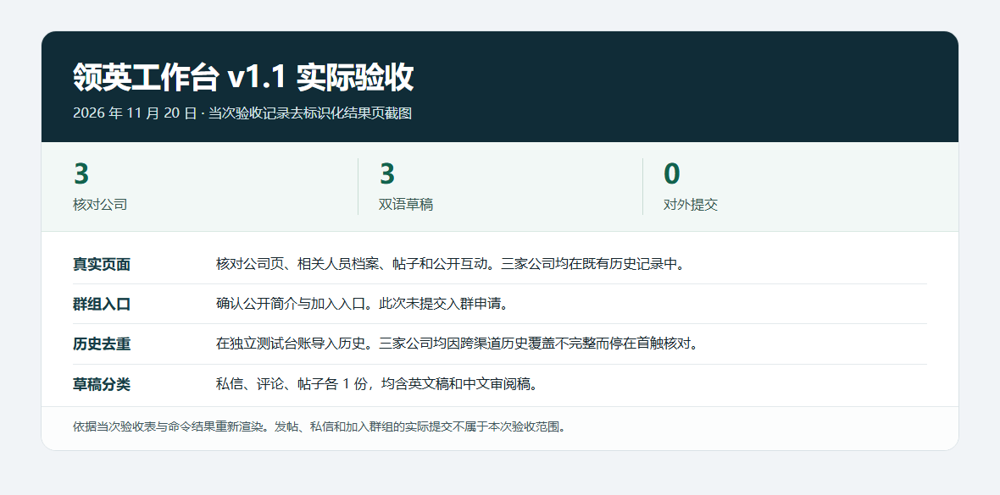

# v1.1 实际验收记录

验收日期为 2026 年 11 月 20 日。此次验收涵盖领英页面只读核对、历史记录去重、双语草稿及独立台账。

| 环节 | 实际结果 |
| --- | --- |
| 页面与线索核对 | 核对 3 家公司对应的真实公司页、相关人员档案、帖子及公开互动。三家公司均在既有历史记录中。 |
| 群组入口 | 核对 1 个群组的公开简介与加入入口。本轮未提交加入申请。 |
| 跨渠道首触检查 | 将历史记录导入独立测试台账。3 家公司的跨渠道历史覆盖均不完整，全部停在首触核对环节。 |
| 草稿与分类 | 完成私信、评论、帖子各 1 份，均含英文稿和中文审阅稿。台账分类核对成功。 |
| 对外提交 | 共 0 次。本轮未提交私信、评论、帖子、连接邀请或入群申请。 |

截图由当次验收表和命令结果中的统计结论去标识化后重新渲染。此次验收验证了读取页面、查重、写稿和本地台账流程。各客户端的发帖、消息提交及入群审批仍需使用者按实际环境分别验证。
